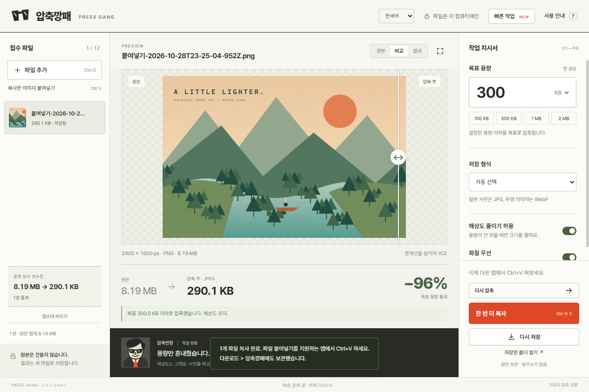

# 압축깡패 · Press Gang

**“파일이 너무 큽니다.” 그 말, 그만 듣죠.**

목표 용량에 맞춰 사진을 줄이는 무료 Windows 앱입니다. 사진을 붙여넣고, 용량을 정하고, 결과를 비교한 뒤 파일로 복사하세요. 압축반장이 용량만 혼내줍니다. 원본은 무사합니다.

[English](README.md) · [무료 베타 다운로드](https://github.com/qkdlsem-maker/press-gang/releases/tag/v2.0.1-beta.1) · [문제 제보](https://github.com/qkdlsem-maker/press-gang/issues/new/choose)

## 실제 작동 모습

[한국어 시연 영상](https://github.com/qkdlsem-maker/press-gang/releases/download/v2.0.1-beta.1/PressGang-Demo-ko.mp4) · [영문 시연 영상](https://github.com/qkdlsem-maker/press-gang/releases/download/v2.0.1-beta.1/PressGang-Demo-en.mp4)

실제 앱에서 샘플 일러스트를 붙여넣고 압축·비교·파일 복사한 녹화입니다. 압축률은 이미지와 설정에 따라 달라지며 모든 사진에서 같은 결과가 나온다는 뜻은 아닙니다.

## 설치

1. **[PressGang-Setup-2.0.1-beta.1-x64.exe](https://github.com/qkdlsem-maker/press-gang/releases/download/v2.0.1-beta.1/PressGang-Setup-2.0.1-beta.1-x64.exe)**를 받으세요. `Source code`는 개발용 소스이며 설치 파일이 아닙니다.
2. 설치 언어를 고르고 안내에 따라 설치하세요. 관리자 권한 없이 현재 Windows 사용자에게 설치됩니다.
3. 시작 메뉴에서 **압축깡패**를 실행하세요. 앱 상단에서 **한국어 / English**를 바꿀 수 있고 작업 목록과 결과는 유지됩니다.

**공개 베타 · Windows x64 · Windows 11에서 검증 · 계정과 결제 없음.** 현재 설치 파일은 **코드 서명이 없습니다.** Windows에서 알 수 없는 게시자 또는 평판 경고가 나타날 수 있습니다. 이 저장소에서 받은 파일인지 확인하고 릴리스의 `SHA256SUMS.txt`와 대조하세요. 보안 기능을 끄지 마세요. [설치·업데이트·삭제 안내](docs/INSTALL.ko.md).

## 이렇게 쓰세요

| 작업 | 방법 |
| --- | --- |
| 사진 파일 접수 | 끌어놓기 또는 Ctrl+O |
| 복사한 사진·스크린샷 붙여넣기 | Ctrl+V |
| 붙여넣고 현재 설정으로 바로 압축 | Ctrl+Shift+V |
| 접수된 사진 압축 | Ctrl+Enter |
| 선택한 결과를 파일로 복사 | Ctrl+Shift+C |
| 선택한 결과를 폴더에 저장 | Ctrl+S |

- **500 KB, 1 MB**처럼 목표를 정하면 각 사진에 따로 적용합니다.
- 전후 비교와 실제 결과 용량을 확인한 뒤 보내세요.
- 선택한 한 장만 다시 압축하거나 완료된 파일을 한꺼번에 복사·저장할 수 있습니다.
- **빠른 작업 → 탐색기 우클릭 메뉴**를 켜면 사진 한 장을 500 KB 또는 1 MB 목표로 압축·저장합니다. Windows 11에서는 **더 많은 옵션 표시**에 나타납니다. 목표를 넘긴 결과는 자동 저장하지 않고 앱에 표시합니다.

파일 복사는 압축된 바이트를 그대로 유지합니다. 상대 앱이 파일 붙여넣기를 지원하지 않거나 첨부 사진을 다시 인코딩할 수 있습니다. 이때는 저장한 파일을 직접 첨부하세요. 복사·끌어내기·빠른 압축 결과는 **다운로드 → 압축깡패**에 보관합니다. 한국어·영어에서 같은 폴더를 쓰며, 접수대 비우기나 앱 종료로 저장한 결과를 지우지 않습니다.

## 지원 범위

| 항목 | 동작 |
| --- | --- |
| JPG, PNG, 정지 WebP 입력 | 최대 12장, 한 장 100 MiB·8천만 픽셀, 전체 350 MiB |
| 자동 선택 | 일반 사진은 JPEG, 투명 이미지는 WebP |
| 자동 모드에서 이미 목표 이하인 파일 | 원본 바이트 그대로 반환 |
| JPG 직접 선택 | 투명한 부분을 흰색으로 변경 |
| 화질 우선 / 해상도 줄이기 허용 | 인코더 품질과 크기 축소 여부 조절 |
| 목표를 달성하지 못할 때 | 목표 초과 표시 |
| PDF·영상·애니메이션·PNG 출력 | 이번 베타에서는 미지원 |

용량 입력에서 1 MB는 1,000,000바이트이며 목표는 10 KB~100 MiB입니다. 압축으로 화질이나 해상도가 낮아질 수 있습니다. 재인코딩하면 EXIF 회전을 적용하고 메타데이터를 제거합니다. 원본 그대로 반환한 파일은 메타데이터를 유지합니다. ‘화질 우선’은 인코더 설정이며 사람이 느끼는 화질 보장이 아닙니다.

컴퓨터 안에서 처리하며 파일 업로드·계정·광고·추적·자동 시작 등록·자동 업데이트가 없습니다. 클립보드는 붙여넣을 때만 읽습니다. 세션 임시 복사본은 정상 종료 시 삭제하지만 비정상 종료 시 Windows 임시 폴더에 남을 수 있습니다.

## 베타 의견을 보내주세요

[한국어·영어 문제 제보](https://github.com/qkdlsem-maker/press-gang/issues/new/choose)에 앱·Windows 버전, 설정, 재현 순서와 실제 결과를 적어주세요. 원본 사진은 필수가 아닙니다. 화면의 개인 내용과 경로는 가린 뒤 공유하세요. 설치, 다른 앱에 붙여넣기, 실제로 다시 쓰게 되는지에 대한 의견을 받고 있습니다.

## 소스와 이용 안내

공식 베타는 무료로 설치·사용할 수 있습니다. **무료 베타가 곧 오픈소스 라이선스는 아닙니다.** 앱 자체 소스는 기존 `UNLICENSED` 상태를 유지합니다. 확인과 문제 제보를 위해 공개하며 일반적인 코드 재사용·재배포 권한을 새로 부여하지 않습니다. 외부 구성요소는 각자의 라이선스를 따릅니다. [베타 이용 고지](docs/BETA-USE-NOTICE.txt), [외부 라이브러리 고지](docs/THIRD-PARTY-NOTICES.txt), [라이브러리 소스 위치](docs/LIBRARY-SOURCES.txt)를 참고하세요.

화면·캐릭터·샘플 일러스트는 이 프로젝트에서 제작했습니다. Electron, sharp/libvips, Pretendard를 사용합니다. 개발·빌드는 [영문 README](README.md#source-and-development)를 참고하세요.
