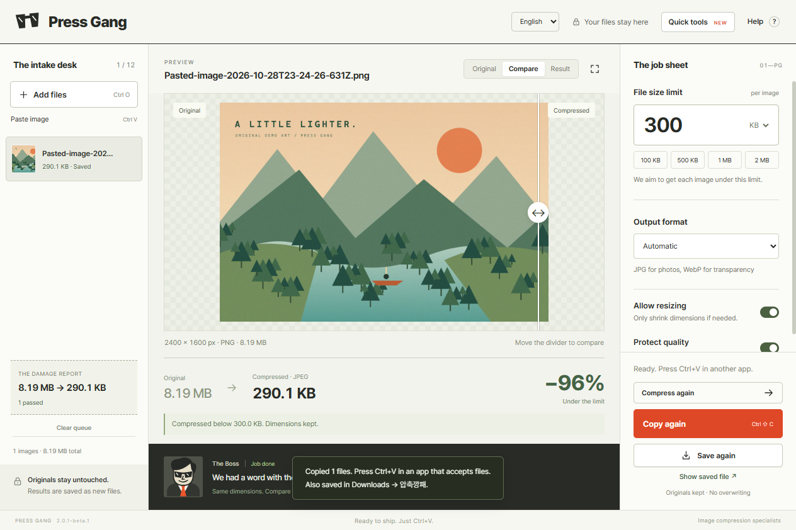
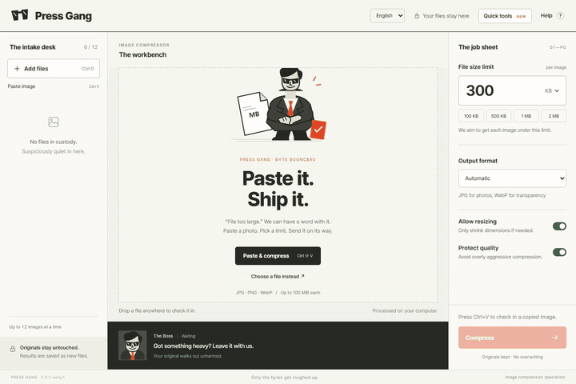

# Press Gang · 압축깡패

**“File too large.” We can have a word with it.**

A free Windows image compressor with a file-size limit and a very serious pair of sunglasses. Paste an image, pick a limit, compare the result, then copy the compressed file into an app that accepts files. Your original walks out unharmed.

[한국어 소개](README.ko.md) · [Download the free beta](https://github.com/qkdlsem-maker/press-gang/releases/tag/v2.0.1-beta.1) · [Report a bug](https://github.com/qkdlsem-maker/press-gang/issues/new/choose)



## See it work



[Watch the English demo](https://github.com/qkdlsem-maker/press-gang/releases/download/v2.0.1-beta.1/PressGang-Demo-en.mp4) · [한국어 시연](https://github.com/qkdlsem-maker/press-gang/releases/download/v2.0.1-beta.1/PressGang-Demo-ko.mp4)

These are recordings of the real app compressing, comparing and copying the included demo illustration. Results vary by image, limit and settings. This is a demonstration, not a general compression benchmark.

## Install

1. Download **[PressGang-Setup-2.0.1-beta.1-x64.exe](https://github.com/qkdlsem-maker/press-gang/releases/download/v2.0.1-beta.1/PressGang-Setup-2.0.1-beta.1-x64.exe)**. The “Source code” downloads are for developers.
2. Choose English or Korean in the installer. It installs for your Windows user without administrator rights.
3. Open **압축깡패 / PressGang** from the Start menu. Choose **English** or **한국어** in the app header. Language changes keep your queue and completed results.

**Public beta · Windows x64 · Tested on Windows 11 · No account or payment required.** The installer is **unsigned**. Windows may show an unknown-publisher or reputation warning. Check the download source and compare its SHA-256 with the release's `SHA256SUMS.txt`. Do not disable security features. [Installation, updating and uninstalling](docs/INSTALL.en.md).

## The short workflow

| Action | Shortcut |
| --- | --- |
| Add image files | Ctrl+O, or drag them in |
| Paste a copied image file or screenshot | Ctrl+V |
| Paste and compress with current settings | Ctrl+Shift+V |
| Compress the queue | Ctrl+Enter |
| Copy the selected result as a file | Ctrl+Shift+C |
| Save the selected result to a folder | Ctrl+S |

- Choose **500 KB**, **1 MB** or a custom limit, applied separately to each image.
- Inspect the before/after divider and actual output size before sending.
- Recompress the selected image, or copy/save all completed results.
- Enable **Quick tools → Explorer context menu** for one-image 500 KB / 1 MB jobs. On Windows 11, use **Show more options**. Over-limit results stay in the app for review instead of being saved automatically.

Copy preserves the compressed file's bytes. Some destination apps do not accept pasted files or re-encode attachments; attach the saved file directly if needed. Copied, dragged and quick-compressed results stay in **Downloads → 압축깡패**. The folder name is the same in both languages. Clearing the queue or closing the app does not delete saved results.

## What it does, and its limits

| Input / option | Behavior |
| --- | --- |
| JPG, PNG, still WebP | Up to 12 images; 100 MiB and 80 megapixels each; 350 MiB per queue |
| Automatic output | JPEG for photos, WebP for transparency |
| Already under the limit in Automatic mode | Original bytes returned unchanged |
| Explicit JPEG output | Transparent areas become white |
| Protect quality / Allow resizing | Controls encoder quality and whether dimensions can shrink |
| Limit cannot be reached | Result is clearly marked over the limit |
| PDFs, video, animation, PNG output | Not supported in this beta |

1 MB = 1,000,000 bytes in the selector; target range 10 KB–100 MiB. Encoding can reduce quality or dimensions. Encoded results apply EXIF rotation and strip metadata; unchanged originals retain metadata. “Protect quality” is an encoder policy, not a perceptual-quality guarantee.

Processing is local. No uploads, accounts, ads, tracking, auto-start registration or automatic updater. The clipboard is read only after a paste action. Session copies are removed on normal exit; a crash may leave copies in the Windows temporary folder.

## Help shape the beta

[Open a Korean or English bug report](https://github.com/qkdlsem-maker/press-gang/issues/new/choose). Include the app/Windows versions, settings, reproduction steps and actual result. Original images are optional. Remove private content and personal paths from screenshots. Feedback on installation, pasting into other apps and repeat use is especially helpful.

## Source and development

The official beta is free to install and use. **Free beta does not mean an open-source license:** original application source remains `UNLICENSED`, published for inspection and issue reporting without a new general reuse or redistribution license. Third-party components keep their own licenses. See [beta use notice](docs/BETA-USE-NOTICE.txt), [third-party notices](docs/THIRD-PARTY-NOTICES.txt) and [library source references](docs/LIBRARY-SOURCES.txt).

The interface, characters and sample illustration were made for this project. Built with Electron, sharp/libvips and Pretendard. Verified on Windows x64 with Node 24 and pnpm 11:

```powershell
pnpm install --frozen-lockfile
pnpm test
pnpm start
node scripts/licenses.cjs
pnpm build
```

Set `PRESSGANG_QA=1` when starting the development app for actual UI/IPC checks. Set `PRESSGANG_DEMO=1` and `PRESSGANG_LANG=en` or `ko` to record a demo with FFmpeg on PATH. Test/demo runs restore the clipboard after completion. Packaged diagnostics: `PressGang.exe --self-test --report <absolute-report-path>`.
